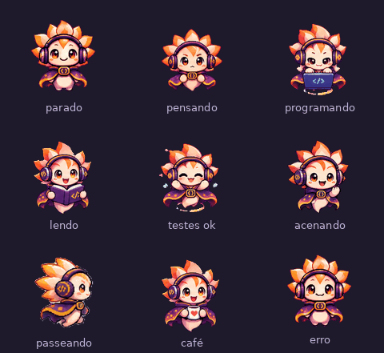

# Clawd

Mascote de desktop em pixel art que reage ao [Claude Code](https://claude.com/claude-code).
Janela transparente, sempre no topo, feita com PyQt6.



## O que ele faz
- Mostra o que o Claude está fazendo: pensando, programando, lendo, buscando, testando, comemorando
  testes que passam, ficando triste quando falham, assustado com erros, alerta quando pede permissão.
- Parado, ele faz variações (ler, tomar café, acenar...), cochila e dorme, e passeia pela tela
  (acena no ponto mais distante e volta ao canto inferior direito).
- Clique = carinho · arrastar = mover · roda do mouse = tamanho · duplo clique = menu (correção do ditado, som,
  uso de tokens, sair).

## Instalar
```bash
python -m venv .venv && .venv/bin/pip install PyQt6 python-xlib
.venv/bin/python clawd.py
```
`CLAWD_ANDAR=0` desliga o passeio; `CLAWD_VOICE=0` desliga a escuta por voz; `CLAWD_SPEAK=0` desliga a fala.
Linux (X11/XWayland). Para abrir no login, copie `clawd.desktop.example` para `~/.config/autostart/clawd.desktop`
e troque `CAMINHO`.

## Ligar ao Claude Code
Os hooks escrevem o estado em `$XDG_RUNTIME_DIR/clawd.state`. Copie `settings.example.json` para o bloco
`hooks` do seu `~/.claude/settings.json`, trocando `CAMINHO` pela pasta do projeto. `clawd-hook.py` lê o JSON
do hook e escolhe o estado pela ferramenta usada.

## Skins
O botão de losango no menu (duplo clique) troca a skin e lembra a escolha (`~/.clawd-skin`). Vêm 6 além do
padrão: **Brasa, Floresta, Gelo, Sakura e Vampiro** (só recolorem o Clawd) e **Luna**, um personagem
inteiro diferente (cabelo de cristal azul, fones verde-água e capa estrelada) com todos os quadros próprios. Uma skin é uma pasta em `skins/<nome>/`:
- `skin.json` com uma receita de cores, sem PNGs: `{"nome": "Gelo", "recolorir": {"cabelo": 180, "capa": -50}}`.
  `cabelo` e `capa` giram o matiz em graus (a pele clara não muda); `cabelo_sat` e `capa_sat` multiplicam a
  saturação (0 = cinza).
- e/ou PNGs próprios com os mesmos nomes de `sprites/` (`f0.png`...). O que faltar vem da skin padrão, então
  dá para fazer uma skin só com algumas poses, ou com outro personagem inteiro.

## Vida extra
- **Arrastar:** segurando, ele fica pendurado e balança conforme você move; ao soltar no ar, cai, quica e pousa.
- **Balão de texto** acima dele para avisos.
- **Hábitos** (`habitos.py`): saudação do dia ("Bom dia!"), aviso se terminar uma tarefa de madrugada, lembrete de
  pausa depois de 2 h de trabalho contínuo (`CLAWD_DESCANSO_MIN`, 0 desliga) e **conquistas** (primeiro teste
  verde, consertou um teste, coruja, maratonista, sequência de 3 e 7 dias, 100 pedidos). O progresso fica em
  `~/.local/state/clawd/estado.json` e a lista aparece no menu.

## Limites do plano no menu
O duplo clique abre um menu com barras de uso do **limite de 5 horas**, do **limite semanal** e do **contexto da
conversa**, com a hora da renovação e uma projeção do ritmo ("no ritmo atual, chega a ~60% até renovar"). Os
números vêm do próprio Claude Code, por meio do `statusLine` (veja o bloco `statusLine` em `settings.example.json`):
`clawd-statusline.py` guarda os limites e um histórico curto em `$XDG_RUNTIME_DIR/clawd.limites.json` e não
imprime nada na linha de status. Eles só atualizam enquanto o Claude Code está em uso.

## Ditado por atalho (aperta para gravar, aperta para enviar)
1. Em *Configurações do Sistema → Atalhos → Comandos personalizados*, crie um atalho de teclado que rode
   `CAMINHO/clawd-voz gravar`.
2. Aperte o atalho: o Clawd fica ouvindo. Fale à vontade, com pausas.
3. Aperte de novo: ele transcreve tudo de uma vez (offline), corrige o português, digita no terminal do Claude
   e aperta Enter.

| Variável | Efeito |
|---|---|
| `CLAWD_DITADO_ENTER=0` | digita mas não aperta Enter (para você revisar) |
| botão **H** do menu (duplo clique) | liga/desliga a correção com o Haiku; desligado = local. A variável abaixo, se definida, tem prioridade |
| `CLAWD_DITADO_CORRECAO=local` | padrão: regras locais (espaços, maiúsculas, pontuação, "hum") |
| `CLAWD_DITADO_CORRECAO=haiku` | também revisa com o Claude Haiku (`claude -p`, sem ferramentas); **o texto é enviado à Anthropic** |
| `CLAWD_DITADO_CORRECAO=off` | sem correção |
| `CLAWD_DITADO=0` | desliga o recurso |

O arquivo `vocabulario.txt` guarda palavras que o whisper costuma errar: uma por linha (dica para ele escrever certo) ou `errado => certo` (troca depois da transcrição). Edite à vontade; vale no próximo ditado.

## Voz (opcional)
`voice.py` escuta o microfone (faster-whisper, offline) e `speak.py` fala ao fim de cada resposta (Piper ou
Kokoro). Os modelos vão em `voices/` (fora do git, são grandes). Instale as dependências extras do
`requirements.txt`.

## Sprites
Os quadros ficam em `sprites/` (`{folha}{n}.png`) e vêm de folhas 8x4 com fundo magenta:
```bash
python tools/montar_frente.py sprites c=costas.png d=direita_acoes.png ...
python tools/galeria.py     # gera galeria.html com todas as animações
python tools/gerar_gif.py   # gera docs/clawd.gif (o GIF deste README)
```
As animações e o mapeamento estado → animação estão no topo de `clawd.py` (`ANIMS`, `STATE_SPRITE`).

## Créditos
Os sprites do Clawd e da Luna foram gerados com IA (ChatGPT, da OpenAI) e depois recortados e limpos com
`tools/montar_frente.py`. A Luna foi cortada com `ESCALA_CELULA=100 python tools/montar_frente.py skins/luna f=... g=...`,
um prefixo por folha (veja a lista na seção Sprites).

## Licença
Código sob licença MIT (veja `LICENSE`). Os sprites foram gerados por IA; confira os termos de uso do gerador antes de redistribuí-los.

## Arquivos
| Arquivo | Função |
|---|---|
| `clawd.py` | o mascote (janela, animações, passeio, menu) |
| `clawd-hook.py` | hook do Claude Code: escolhe o estado |
| `clawd-statusline.py` | statusLine do Claude Code: guarda os limites de uso para o menu |
| `skins.py` | skins: receitas de cor e quadros próprios |
| `habitos.py` | saudações, lembretes e conquistas |
| `usage.py` | lê os limites guardados e estima o ritmo |
| `voice.py`, `ditado.py`, `speak.py`, `clawd-voz` | escuta, ditado por atalho e fala (opcionais) |
| `tools/` | recorte das folhas e galeria |
