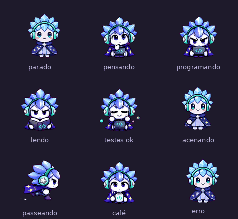

# Clawd

Mascote de desktop em pixel art que reage ao [Claude Code](https://claude.com/claude-code).
Janela transparente, sempre no topo, feita com PyQt6.


## O que ele faz
- Mostra o que o Claude está fazendo: pensando, programando, lendo, buscando, testando, comemorando
  testes que passam, ficando triste quando falham, assustado com erros, alerta quando pede permissão.
- Parado, ele faz variações (ler, tomar café, acenar...), cochila e dorme, e passeia pela tela
  (acena no ponto mais distante e volta ao canto inferior direito).
- Clique = carinho · arrastar = mover · roda do mouse = tamanho · duplo clique = menu (correção do ditado, som,
  uso de tokens, sair).

## Instalar
```bash
git clone https://github.com/FabioCastilho/clawd-mascot && cd clawd-mascot
./install.sh          # cria o .venv, instala as dependências, liga os hooks e o statusLine do Claude Code e o autostart
./install.sh --voz    # também escuta/fala/ditado (dependências grandes) e o atalho Ctrl+Alt+Espaço (KDE)
.venv/bin/python clawd.py
```
O instalador faz backup do seu `~/.claude/settings.json`, só acrescenta o que é do Clawd (pode rodar de novo sem duplicar)
e não sobrescreve um `statusLine` que você já tenha (avisa como encadear). `./install.sh --desinstalar` tira tudo.
Opções: `--sem-autostart`, `--dry-run` (só mostra o que faria).

`CLAWD_ANDAR=0` desliga o passeio; `CLAWD_VOICE=0` desliga a escuta por voz; `CLAWD_SPEAK=0` desliga a fala.
Linux (X11/XWayland). À mão, sem o script: `pip install PyQt6 Pillow numpy python-xlib`, copie `settings.example.json`
para o `~/.claude/settings.json` e `clawd.desktop.example` para `~/.config/autostart/`, trocando `CAMINHO`.

## Ligar ao Claude Code
Os hooks escrevem o estado em `$XDG_RUNTIME_DIR/clawd.state`. `clawd-hook.py` lê o JSON do hook e escolhe o estado
pela ferramenta usada. O `install.sh` já configura isso; o `settings.example.json` mostra o resultado.

## Skins
O botão de losango no menu (duplo clique) troca a skin e lembra a escolha (`~/.clawd-skin`). Vêm 6 além do
padrão: **Brasa, Floresta, Gelo, Sakura e Vampiro** (só recolorem o Clawd) e **Luna**, um personagem
inteiro diferente (cabelo de cristal azul, fones verde-água e capa estrelada) com todos os quadros próprios.

 Uma skin é uma pasta em `skins/<nome>/`:
- `skin.json` com uma receita de cores, sem PNGs: `{"nome": "Gelo", "recolorir": {"cabelo": 180, "capa": -50}}`.
  `cabelo` e `capa` giram o matiz em graus (a pele clara não muda); `cabelo_sat` e `capa_sat` multiplicam a
  saturação (0 = cinza).
- e/ou PNGs próprios com os mesmos nomes de `sprites/` (`f0.png`...). O que faltar vem da skin padrão, então
  dá para fazer uma skin só com algumas poses, ou com outro personagem inteiro.

## Vida extra
- **Arrastar:** segurando, ele fica pendurado e balança conforme você move; ao soltar no ar, cai, quica e pousa.
- **Balão de texto** acima dele para avisos.
- **Hábitos** (`habitos.py`): saudação do dia ("Bom dia!"), aviso se terminar uma tarefa de madrugada, lembrete de
  pausa depois de 2 h de trabalho contínuo (`CLAWD_DESCANSO_MIN`, 0 desliga) e **conquistas** (primeiro teste
  verde, consertou um teste, coruja, maratonista, sequência de 3 e 7 dias, 100 pedidos). O progresso fica em
  `~/.local/state/clawd/estado.json` e a lista aparece no menu.

## Limites do plano no menu
O duplo clique abre um menu com barras de uso do **limite de 5 horas**, do **limite semanal** e do **contexto da
conversa**, com a hora da renovação e uma projeção do ritmo ("no ritmo atual, chega a ~60% até renovar"). Os
números vêm do próprio Claude Code, por meio do `statusLine` (veja o bloco `statusLine` em `settings.example.json`):
`clawd-statusline.py` guarda os limites e um histórico curto em `$XDG_RUNTIME_DIR/clawd.limites.json` e não
imprime nada na linha de status. Eles só atualizam enquanto o Claude Code está em uso.

**Avisos de limite:** o Clawd solta um balão (uma vez por janela) quando o limite de 5 h ou o semanal passa de 80% e de 95%,
e quando o ritmo atual vai esgotá-lo antes da renovação ("No ritmo atual o limite 5 h acaba em ~40 min"). Não avisa
se os dados têm mais de 30 min (Claude Code parado). Para ver o balão sem esperar, grave um `clawd.limites.json` falso
com `five_hour.used_percentage` em 85 (o `statusLine` o sobrescreve na próxima atualização).

## Ditado por atalho (aperta para gravar, aperta para enviar)
1. Em *Configurações do Sistema → Atalhos → Comandos personalizados*, crie um atalho de teclado que rode
   `CAMINHO/clawd-voz gravar`.
2. Aperte o atalho: o Clawd fica ouvindo. Fale à vontade, com pausas.
3. Aperte de novo: ele transcreve tudo de uma vez (offline), corrige o português, digita no terminal do Claude
   e aperta Enter.

| Variável | Efeito |
|---|---|
| `CLAWD_DITADO_ENTER=0` | digita mas não aperta Enter (para você revisar) |
| botão **H** do menu (duplo clique) | liga/desliga a correção com o Haiku; desligado = local. A variável abaixo, se definida, tem prioridade |
| `CLAWD_DITADO_CORRECAO=local` | padrão: regras locais (espaços, maiúsculas, pontuação, "hum") |
| `CLAWD_DITADO_CORRECAO=haiku` | também revisa com o Claude Haiku (`claude -p`, sem ferramentas); **o texto é enviado à Anthropic** |
| `CLAWD_DITADO_CORRECAO=off` | sem correção |
| `CLAWD_DITADO=0` | desliga o recurso |

O arquivo `vocabulario.txt` guarda palavras que o whisper costuma errar: uma por linha (dica para ele escrever certo) ou `errado => certo` (troca depois da transcrição). Edite à vontade; vale no próximo ditado.

## Voz (opcional)
`voice.py` escuta o microfone (faster-whisper, offline) e `speak.py` fala ao fim de cada resposta. A voz fica em
`voices/current`, no formato `motor:voz`:

| Valor | Motor |
|---|---|
| **`supertonic:F4`** (a que uso) | [Supertonic 3](https://github.com/supertone-oss-archive/supertonic): 10 vozes (`F1`-`F5`, `M1`-`M5`) |
| `pocket:rafael` | [Pocket TTS](https://github.com/kyutai-labs/pocket-tts), sobe um servidor local (porta 8765) |
| `kokoro:pf_dora`, `kokoro:pm_alex` | Kokoro (pt-BR, offline) |
| `pt_BR-faber-medium` etc. | Piper |

Instalação do Supertonic (só CPU, ~200 MB):
```bash
python -m venv .venv-super && .venv-super/bin/pip install supertonic soundfile
echo -n supertonic:F4 > voices/current
```
Os modelos do Kokoro/Piper vão em `voices/` (fora do git, são grandes); veja `requirements.txt`.

### Qual voz usar? Testes só com CPU
Testei vozes locais em pt-BR numa máquina **sem GPU forte** (CPU de 16 threads, GTX 1650 de 4 GB), com a frase
"Olá, eu sou a Clau, sua assistente. O que vamos fazer hoje?" e um parágrafo de ~24 s. "Velocidade" é quanto tempo leva
para gerar 1 s de fala (menor = melhor):

| Motor | Onde roda | Velocidade | Instalação | Resultado |
|---|---|---|---|---|
| **Supertonic 3** | CPU | **0,2 s** (parágrafo de 24 s em 4,7 s) | 200 MB | **a escolhida**: rápida, carrega em 0,5 s, sem servidor |
| Pocket TTS | CPU | 0,5 s (frase de 4 s em 2 s) | 1,3 GB | boa, mas precisa de servidor (modelo leva ~12 s para carregar) |
| Kokoro | CPU | não medi | ~340 MB | boa e leve; só 3 vozes em pt-BR |
| Chatterbox | CPU | 4,5 s | 6 GB | funciona, mas lento demais; na GPU de 4 GB faltou memória e em `float16` gerou áudio inválido |
| Qwen3-TTS 0.6B | CPU | ~5 s | 2,4 GB | lento; na GPU de 4 GB, `float16` deu áudio inválido e `float32` faltou memória |

Chatterbox e Qwen3-TTS têm qualidade ótima, mas pedem uma GPU maior (e `bfloat16`); numa máquina só com CPU ou com uma
placa pequena, não compensam. Seus números podem variar.

**Licenças:** o código do Supertonic é MIT, mas o repositório foi **arquivado** pelo autor (sem atualizações) e os pesos
do modelo usam a licença **OpenRAIL-M**, que traz restrições de uso; leia-a antes de redistribuir. O Pocket TTS é MIT.

## Sprites
Os quadros ficam em `sprites/` (`{folha}{n}.png`) e vêm de folhas 8x4 com fundo magenta:
```bash
python tools/montar_frente.py sprites c=costas.png d=direita_acoes.png ...
python tools/galeria.py     # gera galeria.html com todas as animações
python tools/gerar_gif.py   # gera docs/clawd.gif (o GIF deste README)
```
As animações e o mapeamento estado → animação estão no topo de `clawd.py` (`ANIMS`, `STATE_SPRITE`).

## Créditos
Os sprites do Clawd e da Luna foram gerados com IA (ChatGPT, da OpenAI) e depois recortados e limpos com
`tools/montar_frente.py`. A Luna foi cortada com `ESCALA_CELULA=100 python tools/montar_frente.py skins/luna f=... g=...`,
um prefixo por folha (veja a lista na seção Sprites).

## Licença
Código sob licença MIT (veja `LICENSE`). Os sprites foram gerados por IA; confira os termos de uso do gerador antes de redistribuí-los.

## Arquivos
| Arquivo | Função |
|---|---|
| `clawd.py` | o mascote (janela, animações, passeio, menu) |
| `clawd-hook.py` | hook do Claude Code: escolhe o estado |
| `clawd-statusline.py` | statusLine do Claude Code: guarda os limites de uso para o menu |
| `skins.py` | skins: receitas de cor e quadros próprios |
| `habitos.py` | saudações, lembretes e conquistas |
| `usage.py` | lê os limites guardados e estima o ritmo |
| `voice.py`, `ditado.py`, `speak.py`, `clawd-voz` | escuta, ditado por atalho e fala (opcionais) |
| `install.sh`, `tools/instalar.py` | instalação: venv, hooks, statusLine, autostart, atalho |
| `tools/` | recorte das folhas, galeria e GIFs |
